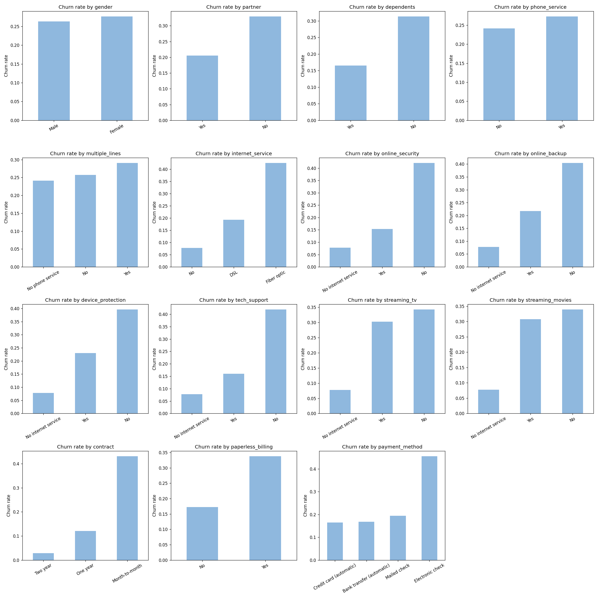
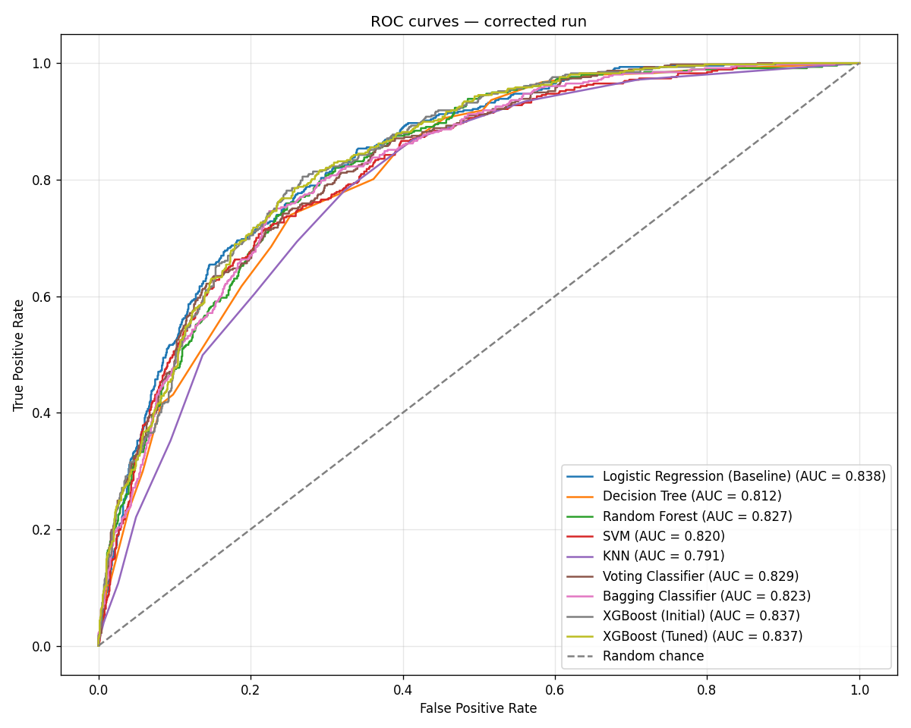
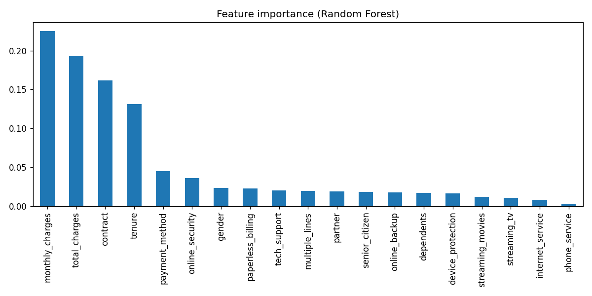

# Telecom Customer Churn Prediction — Project Review

Predicting which telecom customers will cancel their service, using demographic, service and billing data (5,634 customers, 19 features, 27% churn).

**Project context:** Collaborative machine learning course project, University of West Florida, Fall 2024 (Kaggle competition held within the class).

**My contribution:** Exploratory data analysis, XGBoost modeling and tuning, model comparison, and participation in selecting the final XGBoost model.

The original notebook is not published; its historical results are summarized below. The 2026 technical review and its corrections are my own work.

---

## Original results (2024)

**Outcome:** Logistic Regression and tuned XGBoost both reached a Kaggle competition score (ROC-AUC) of **0.856**. The team selected XGBoost for the final submission.

---

## EDA highlights



- **Contract:** month-to-month customers churn at 43%, one-year at 12%, two-year at 3%.
- **Tenure:** 53% of customers in their first 6 months churn, compared with 10% after 4 years.
- **Payment method:** electronic check users churn at 46%, about 2.5× the rate of automatic payments (16–17%).
- **Add-on services:** customers without online security or tech support churn at ~42%, compared with ~15–16% for those who have them.

---

## 2026 Technical Review

When I re-ran the project, I found four problems:

| # | Problem | Effect | Fix |
|---|---|---|---|
| 1 | The shared tuning helper ran `RandomizedSearchCV` but returned the **untuned** model | All baseline models were evaluated with default parameters, so the model comparison was not fair | Return `best_estimator_` |
| 2 | F1 threshold for XGBoost was selected **on the test set** | Test F1 (0.639) was optimistic | Threshold chosen with 5-fold CV on training data only |
| 3 | Mean imputer for `total_charges` was re-fit on the test data | Minor leakage | Fit on training data, apply to test |
| 4 | Metrics table was typed in by hand; feature-importance text did not match the model | Reported top features (payment method, streaming movies) were wrong | Table and importance plot generated from code |

SMOTE was imported in the original notebook but never applied. The review keeps the original setup (no resampling) and does not claim SMOTE.

### Original vs corrected test ROC-AUC

| Model | Original 2024 | Corrected 2026 | Change |
|---|---|---|---|
| Logistic Regression (baseline) | 0.838 | 0.838 | 0.000 |
| Logistic Regression (feature selection) | 0.838 | 0.838 | 0.000 |
| XGBoost (initial) | 0.837 | 0.837 | 0.000 |
| XGBoost (tuned) | 0.837 | 0.837 | 0.000 |
| Voting Classifier | 0.828 | 0.829 | +0.001 |
| Random Forest | 0.819 | 0.827 | +0.008 |
| Bagging Classifier | 0.823 | 0.823 | 0.000 |
| Logistic Regression (PCA) | 0.822 | 0.822 | 0.000 |
| SVM | 0.787 | 0.820 | +0.033 |
| Decision Tree | 0.658 | 0.812 | **+0.154** |
| KNN | 0.761 | 0.792 | +0.031 |

XGBoost F1 with the decision threshold chosen on training data: **0.629** (originally reported 0.639 with the threshold chosen on the test set).

**What changed:** once tuning works, the gap between models shrinks. Decision Tree, SVM and KNN were not weak models; they were untuned.

**Logistic Regression vs XGBoost:** the two models perform equivalently (test ROC-AUC 0.838 vs 0.837; Kaggle 0.85625 vs 0.85634). A bootstrap test on the held-out set shows no meaningful difference: the 95% CI of the AUC difference (LR − XGBoost) is −0.006 to +0.009 and includes zero. The team selected XGBoost for the final submission. In hindsight, given equal performance, Logistic Regression would be the more practical choice: it is simpler, faster to train and tune, and its coefficients are directly interpretable for business stakeholders.



### What actually drives churn



Top features: **monthly charges, total charges, contract type, tenure**. These match the EDA findings.

### Limitations
- **Categorical encoding:** LabelEncoder assigns integer values to categorical variables, implicitly introducing an ordinal relationship between categories. This may affect models such as Logistic Regression, SVM, and KNN, which can interpret these values as ordered or numeric distances.
- **Preprocessing before cross-validation:** Imputation, encoding, scaling, PCA, and feature selection were fitted on the full training set before cross-validation. As a result, cross-validation scores may be somewhat optimistic. The held-out test set remained separate and was not used to fit these transformations.

---

## Business recommendations

These are associations in the data, not proven causes.

1. **Target the first year.** New customers are at the highest risk. Strengthen onboarding during the first 6 months.
2. **Move customers to longer contracts.** Offer incentives to switch from month-to-month to one- or two-year plans.
3. **Encourage automatic payments.** Electronic-check users churn at 2.5× the rate of autopay users.
4. **Bundle security and tech support.** Customers without these services churn about 2.5× more often.
5. **Use model probabilities to prioritize.** Rank customers by predicted churn risk and focus retention budget on the top segment.

---

## Repository structure

```
├── README.md
├── notebooks/churn_2026_review.ipynb   # my review: EDA, corrected models
├── images/                             # figures generated by the notebook
├── results/                            # model_evaluation.csv, original_vs_corrected.csv
└── requirements.txt
```

**Tools:** Python, pandas, scikit-learn, XGBoost, matplotlib, seaborn

*Questions or comments about this technical review are welcome. Please feel free to open a GitHub issue.*
